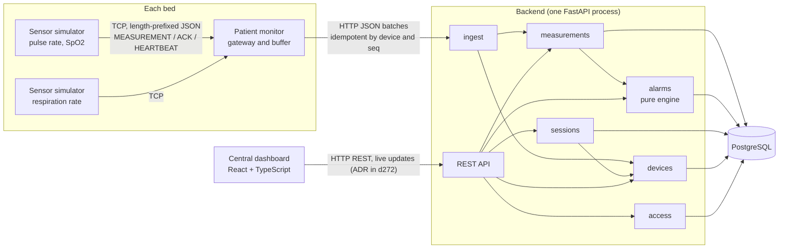
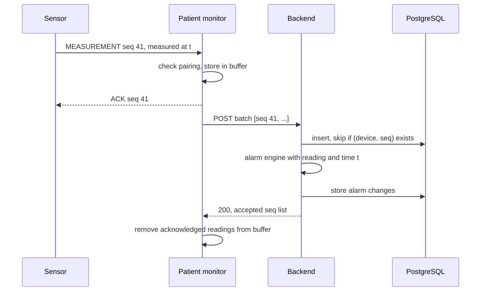

# Architecture: PulseGuard

How PulseGuard is split into components, how they talk, and where each risk from `risk-analysis.md` is handled. Decisions with real alternatives are recorded as ADRs in `docs/adr/`.

Last updated: 2026-11-12. Nothing is built yet; this is the design the code will follow.

> PulseGuard is a simulated system for practising testing. It is not a medical device.

## Components

| Component | Runs as | Responsibility |
|---|---|---|
| Sensor simulator | One asyncio process, one task per sensor | Produces seeded readings for a scenario (normal, tachycardia, desaturation, sensor off); injects faults (delay, drop, duplicate, reorder, disconnect, clock skew) on request |
| Patient monitor | One asyncio process per bed | Accepts sensor connections, checks pairing, acknowledges readings, detects a silent sensor after 15 s, buffers readings on disk while the backend is unreachable, forwards them in batches, sends a heartbeat |
| Backend | One FastAPI process with an internal module per area | Owns all state and rules: sessions, devices, measurements, alarms, access |
| PostgreSQL | One database | The only source of truth; constraints back up the rules that must hold under concurrency |
| Central dashboard | React single page app | Shows open sessions, current values with their age, alarms and history; acknowledges alarms |

## Communication

| Link | Transport | Why | Specified in |
|---|---|---|---|
| Sensor → patient monitor | TCP, length-prefixed JSON, versioned messages | Models a device link where framing, acknowledgement and resend are our own; ADR-002 | `protocol.md` (d237) |
| Patient monitor → backend | HTTP JSON, batches of readings and status events | The backend already serves HTTP; a batch retried after a timeout is safe because readings are idempotent by device and sequence number; ADR-002 | `api.md` (d238) |
| Dashboard → backend | HTTP REST with a token | Ordinary web client; polling or WebSocket is decided in d272 | `api.md` (d238) |

## Backend modules

The backend is a modular monolith (ADR-001): modules live in one process and one database, and call each other only through each module's public functions, never through another module's tables.

| Module | Owns | Requirements |
|---|---|---|
| sessions | Patients, beds, units, admission, discharge, moves | REQ-SES-01 to REQ-SES-05 |
| devices | Device registry, state machine AVAILABLE → ASSIGNED → RETIRED, pairing, connection status | REQ-DEV-01 to REQ-DEV-05, REQ-CON-05 |
| ingest | Accepts batches from monitors, authenticates the device, resolves the session at the measured time | REQ-ACC-03, REQ-MEA-06, REQ-CON-01 |
| measurements | Validation, storage, duplicate detection, ordering, current value | REQ-MEA-01 to REQ-MEA-05 |
| alarms | Alarm engine and alarm lifecycle, limits per session | REQ-ALM-01 to REQ-ALM-08 |
| access | Users, roles, units, tokens | REQ-ACC-01, REQ-ACC-02 |

## Design rules that come from the risks

- **The alarm engine is pure.** It takes the current alarm state, the limits, a reading or a status event, and the time, and returns the new state plus the alarms to raise or change. It does no I/O and never reads the system clock. This lets R-ALM-01, R-ALM-02 and R-ORD-02 be tested in unit and property tests without a network or real waiting, which also addresses R-TEST-01.
- **Time is injected.** Every component gets its clock from outside. The backend uses one `Clock` interface; tests pass a fake clock they move forward.
- **Debounce runs on measured time, not arrival time.** A condition lasting 6 s by the sensor's timestamps raises the alarm, even if the readings arrive late in one batch after an outage (R-REC-01, R-ORD-02).
- **Staleness and loss are detected where the silence is seen.** The monitor sees a silent sensor first and reports a status event (SENSOR_LOST, SENSOR_BACK); the backend sees a silent monitor through missing heartbeats (MONITOR_LOST). The dashboard computes the age of each value from its measured time (R-STALE-01, R-REC-03).
- **The session of a reading is resolved at its measured time.** Ingest looks up which session the sensor was assigned to when the value was measured, not when it arrived (R-ISO-01).
- **Uniqueness is enforced by the database.** One open session per patient, one session per device and one stored reading per device and sequence number are unique constraints, not only checks in code. Project 2 showed that a check followed by an insert lets parallel requests through (F-05 there); this is R-ISO-02 and R-ORD-01 here.
- **Every message carries a version.** Unknown versions are refused without closing the connection (R-PROTO-01).

## What happens to one reading

If the sensor gets no ACK it resends the same seq. If the monitor gets no 200 it keeps the batch and resends it. Both resends are harmless because the backend stores each (device, seq) once.

## Known limits

- Alarms are raised only in the backend. A real bedside monitor alarms locally even when the network is down; here, while the backend is unreachable, no alarm is raised until the buffered readings arrive. This is accepted to keep one alarm engine to test. The dashboard must show that it has lost the backend rather than keep showing old values (REQ-VIEW-04, R-REC-05).
- One backend process, no high availability. A restart must not lose alarm state, so alarm state lives in the database (R-REC-04).
